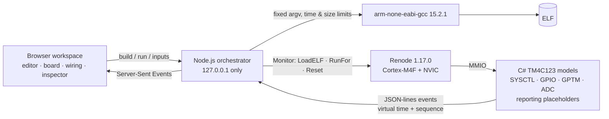

<div align="center">

# TM4C123 Simulator

**Compile real C for the TM4C123GH6PM, execute the ELF on an emulated Cortex-M4F,
and watch it drive a simulated EK-TM4C123GXL LaunchPad and the circuit you wire to it.**

C source → `arm-none-eabi-gcc` → Cortex-M4 ELF → Renode → register-level TM4C123 models → browser

[](https://github.com/Khaledbaniodeh/TM4C123-simulator/actions/workflows/ci.yml)

[**Watch demo**](#watch-the-demo) · [**Quick start**](#quick-start) · [**Try examples**](#try-it-in-5-minutes) · [**Architecture**](#architecture) · [**Engineering feedback**](#feedback-requested-from-ti-engineers) · [**Limitations**](#limitations)


<sub>The current interface, captured by the automated showcase test in CI: example A was compiled
with GCC and executed in Renode, and the red LED is lit because the firmware drove PF1 HIGH
through the GPIO model.</sub>

</div>

> [!IMPORTANT]
> **Independent educational prototype.** Not affiliated with, sponsored by, or endorsed by
> Texas Instruments, and not a TI product. Peripheral behavior is implemented from TI's public
> documentation and checked by automated tests; it has **not** been compared with a physical
> LaunchPad.

## At a glance

- **It runs the real firmware.** Your `main.c` is built by the pinned xPack `arm-none-eabi-gcc`
  15.2.1 and the ELF is executed by [Renode](https://renode.io/) 1.17.0 on a Cortex-M4F with
  NVIC. LEDs, the LCD and the pin table change only because the compiled code wrote to
  simulated registers. No source matching, no scripted animation.
- **It models selected TM4C123GH6PM peripherals at the register level** (C#, inside Renode):
  SYSCTL clock gating and the RCC/RCC2/PLL clock tree, GPIO ports A–F, SysTick, GPTM
  TIMER0–5 and ADC0/ADC1, with precise bus faults. UART, SSI, I2C and PWM are not modeled;
  accesses to them are reported, never silently accepted.
- **You can wire a circuit to it.** LEDs, resistors, pushbuttons, a potentiometer and an
  LCD1602 connect to the LaunchPad's 40 header pins. The firmware drives the outputs through
  the GPIO model, and buttons and the potentiometer become real inputs to the GPIO and ADC
  models.
- **It is tested on every pull request and every push to `main`.** The current baseline is **174 Node tests and
  141 Playwright browser tests**, all against the real toolchain and Renode
  ([latest `main` run](https://github.com/Khaledbaniodeh/TM4C123-simulator/actions/workflows/ci.yml?query=branch%3Amain)).
- **It runs locally.** A small Node.js server on `127.0.0.1` serves the workspace to your
  browser. There is no hosted version.

## Watch the demo

A 76-second single take of the current interface, recorded in GitHub Actions with real
pointer input in headless Chromium at 1280×720, with no cuts. It shows:

1. adding an LED and a resistor from the component library, and dragging them into place;
2. wiring PF1 → resistor → LED → GND;
3. zooming, panning and fitting the view;
4. pressing **Run**: GCC builds example A, Renode runs it, and both the on-board LED and the
   hand-wired LED light.

**Download:** the `new-ui-interaction` artifact (27.8 MB ZIP: MP4, WebM, stills and
frame-timing data) from
[workflow run 40521764767](https://github.com/Khaledbaniodeh/TM4C123-simulator/actions/runs/40521764767)
([direct download](https://github.com/Khaledbaniodeh/TM4C123-simulator/actions/runs/40521764767/artifacts/12741469384),
works only when signed in to GitHub).

> [!NOTE]
> This is a temporary GitHub Actions artifact: GitHub deletes it on **2027-01-25**, and
> downloading it requires a signed-in GitHub account. There is no permanent video link yet.
> It was recorded on `main` at `6e4f684`. Since then, only the Stop handling has changed
> (fix [#38](https://github.com/Khaledbaniodeh/TM4C123-simulator/pull/38)); the interface
> shown is the same.

## Quick start

| Requirement | Details |
|---|---|
| Operating system | Windows 10/11 x64 or Linux x64. Toolchains are pinned for these two only; macOS is not supported. |
| Node.js | 20.11 or newer |
| Git | Any recent version |
| Disk space | About 2 GB free. The installed toolchains take 1.7 GB on Windows and 1.3 GB on Linux; download archives are deleted after extraction. |
| Download | First setup fetches about 440 MB (Windows) or 370 MB (Linux) from the GCC and Renode GitHub releases. |
| Rights | No administrator rights; nothing is installed system-wide. |
| Browser | A current Chrome or Edge (the browser tests run on Chromium) |

**Windows (PowerShell)**

```powershell
git clone https://github.com/Khaledbaniodeh/TM4C123-simulator.git
cd TM4C123-simulator
npm run setup:tools   # pinned GCC + Renode into .tools\, each archive SHA-256 verified
npm ci
npm start
```

If PowerShell reports that `npm.ps1` cannot be loaded because running scripts is disabled,
type `npm.cmd` instead of `npm` (for example `npm.cmd start`). Extraction uses the `tar.exe`
built into Windows.

**Linux (bash)**

```bash
git clone https://github.com/Khaledbaniodeh/TM4C123-simulator.git
cd TM4C123-simulator
npm run setup:tools   # pinned GCC + Renode into .tools/, each archive SHA-256 verified
npm ci
npm start
```

Then open **<http://127.0.0.1:5123/>**. The terminal shows
`TM4C123 Simulator running at http://127.0.0.1:5123/ (local trusted mode)`.

- **Another port:** set `PORT` first: `$env:PORT = 5200; npm start` in PowerShell, or
  `PORT=5200 npm start` in bash.
- **Stop:** press **Ctrl+C** in the terminal. The server stops the running simulation, shuts
  Renode down and exits.
- **Check or remove the toolchains:** `npm run check:tools` reports what is installed.
  The toolchains live only in the gitignored `.tools/` folder ([`tools.lock.json`](tools.lock.json)
  pins the versions and checksums); delete it, or the whole folder, to uninstall.

These exact commands were run on fresh Windows Server 2022 (Windows PowerShell 5.1) and
Ubuntu 24.04 machines with Node 20. On both, the page loaded, example A ran and drove PF1
HIGH, and Ctrl+C shut Renode down
([Quick Start check, 2026-10-30](https://github.com/Khaledbaniodeh/TM4C123-simulator/actions/runs/41027330602)).

## Try it in 5 minutes

The examples below come with the app; pick them from the **Example** list in the top bar.
The first **Run** compiles `main.c` and starts Renode, which takes a few seconds.

**1. Example A: red LED on (PF1).** It is loaded when the app opens.

- **Do:** press **Run**.
- **Expect:**
  - The editor badge changes to **Built**, and the status reads **Running**, with virtual
    time advancing.
  - The LaunchPad's RGB LED glows red, and the bottom bar shows `PF1 → HIGH (GPIO output)`.
  - Open the **Inspector** with the button at the right end of the circuit toolbar.
    **Pins** lists PF1 HIGH, driven by GPIO output.
- **Then:** press **Stop**.

**2. Example F: external LED + button (PA7/PA6).** It loads a wired circuit: an LED and a
220 Ω resistor on PA7 (J1 pin 10), and a pushbutton from PA6 (J1 pin 9) to GND.

- **Do:** press **Run**, then press and hold the pushbutton on the canvas.
- **Expect:**
  - The firmware reads PA6 LOW and drives PA7 HIGH: the external LED lights.
  - Release the button and the firmware turns the LED off.
- **Then:** press **Stop**.

**3. Example M: potentiometer on AIN0 (ADC0 SS3).** A potentiometer wiper is wired to
PE3/AIN0.

- **Do:** press **Run**, then click the potentiometer. The Inspector opens on it with a
  **Position** slider.
- **Expect:** the firmware samples the wiper every 10 ms and picks the LED colour from the
  12-bit result: green below 1/3 of full scale, blue in the middle, red above 2/3.
  - At 95%, **Pins** shows PE3 at 3.135 V (`pot1 → AIN0`), and the LED is red.

**Also try example L** (LCD1602 on Port B, 4-bit mode). Line 1 reads `Hello, TM4C123!`.
Line 2 shows a custom CGRAM heart and a counter. This firmware busy-waits on SysTick, so it
runs well below real time (see [Limitations](#limitations)).

Each of these flows is also an automated test in
[`e2e/showcase.spec.js`](e2e/showcase.spec.js) that runs in CI. For a guided 10-minute
presentation, see [`docs/SHOWCASE_DEMO.md`](docs/SHOWCASE_DEMO.md).

## Gallery

| | |
|---|---|
|  |  |
| **External button and LED** on J1: holding the button lights the LED through the firmware (example F) | **Potentiometer → ADC0** on PE3/AIN0; the firmware picks the LED colour from the 12-bit result (example M) |
|  |  |
| **LCD1602 (HD44780)** on Port B, driven only by the firmware's GPIO writes (example L) | **Wiring:** press on a pin, drag, release on another pin; the wire is validated and undoable |

All gallery images are captured by the automated browser tests from real runs.

## Architecture



- **Virtual time is authoritative.** The orchestrator advances emulation in fixed `RunFor`
  steps, so repeated runs produce identical event timestamps. Wall-clock pacing is only for
  display; the UI shows the measured real-time factor.
- **No log scraping.** Pin state comes from model events; CPU faults come from the ARMv7-M
  SCB registers (CFSR/HFSR/BFAR).
- **The browser never decides hardware state.** External parts only turn wiring into pin
  drives that the GPIO and ADC models apply.
- **Board geometry from TI's CAD data.** The LaunchPad is placed from the SPMR240 design
  files, and all 40 header pins are checked in CI against TI's SPMU296 user guide.

Details: [`docs/TECHNICAL_OVERVIEW.md`](docs/TECHNICAL_OVERVIEW.md) ·
[`docs/PERIPHERAL_MODELS.md`](docs/PERIPHERAL_MODELS.md) ·
[`docs/RUNTIME_EVENTS.md`](docs/RUNTIME_EVENTS.md) ·
[`docs/DECISION_LOG.md`](docs/DECISION_LOG.md) ·
[`docs/PERFORMANCE.md`](docs/PERFORMANCE.md) ·
[`docs/UX_DESIGN.md`](docs/UX_DESIGN.md)

## What works today

**Simulation (Renode + C# models).** Each row has automated tests, unless marked.

| Area | Scope |
|---|---|
| Toolchain | Pinned xPack `arm-none-eabi-gcc` 15.2.1 and Renode 1.17.0, SHA-256 verified; original startup code, linker script and CMSIS-style `TM4C123.h` |
| Core | Cortex-M4F + NVIC, vector-table boot, reset, deterministic virtual time |
| SYSCTL | GPIO/timer/ADC clock gating; RCC/RCC2/PLL clock tree (16–80 MHz) |
| GPIO A–F | Masked DATA, DIR, DEN, pull-up/down, open drain, PF0 LOCK/CR, analog mode, edge interrupts (falling edge tested) |
| SysTick | Interrupt and `COUNTFLAG` polling at the core clock |
| GPTM | TIMER0–5, 16/32-bit periodic with prescaler, timeout interrupts (TIMER0A–2A tested) |
| ADC0/ADC1 | Sample sequencer 3, processor trigger, internal temperature sensor (SS0–SS2 implemented, untested) |
| Faults | Precise bus faults on unclocked and reserved accesses (a missing clock enable produces a HardFault with the documented `BFAR`); CPU fault details from the SCB registers |
| Not modeled | UART, SSI, I2C, PWM and others: **accesses are reported, never silently accepted** |

**Workspace (browser).**

| Area | Scope |
|---|---|
| Board | 40 wireable header pins with live tooltips; SW1/SW2 and RESET; firmware-driven RGB LED; selectable components with honest status |
| Parts | LED, resistor, pushbutton (logic level), potentiometer (ideal divider), LCD1602 (HD44780); logic analyzer is **editor only** |
| Editing | Searchable component library; drag, rotate, duplicate, delete, multi-selection, copy/paste, nudging, undo/redo; new parts placed on free canvas |
| Wiring | Click-to-click or drag-to-connect; pan while wiring; orthogonal routes on a 0.1 in grid that keep clear of unrelated pin pads; segment rerouting; validation of shorts and duplicates |
| Compile problems | Errors, warnings, and notes from GCC and the linker in a Problems list; each goes to its line and column (F8 / Shift+F8 step through them), lines marked in the gutter; linker errors without a line are listed as such, never given one |
| Console | Every message has a severity and a source (build, simulation, GPIO pins, peripherals, inputs, workspace); a compact view folds runs of GPIO pin changes into one line, a detailed view shows each; level, source, and text filters, which never hide an error; repeats counted (×N); compiler output folded under its error; the page keeps at most 400 rows |
| Inspector | Collapsed by default, opens on a selected part; live pin table (digital levels, drivers, and AIN channel + modeled voltage for ADC inputs), ELF summary, capability list |
| Files and safety | `diagram.json` save/load (Wokwi-inspired, full compatibility **not** claimed); source and circuit kept in browser storage across reloads; confirmation before an example or a file replaces edited work; keyboard-accessible toolbar (wiring itself needs a pointer) |

Lab coverage for Experiments 5–10:
[`docs/EXPERIMENT_COMPATIBILITY.md`](docs/EXPERIMENT_COMPATIBILITY.md).

## Limitations

- **Not compared with physical hardware.** Behavior is implemented from public datasheet
  descriptions and verified by tests, not against a real LaunchPad. Simulation results are
  not a substitute for testing on hardware.
- **Approximate timing.** One instruction per clock at the configured system clock; not
  cycle-accurate. Interrupt + `WFI` firmware runs at about real time, but firmware that
  busy-polls a register runs at about 0.07–0.13× real time in CI, and interactive runs
  measured 0.1–0.8× on Windows ([`docs/PERFORMANCE.md`](docs/PERFORMANCE.md)). The UI
  shows the measured factor.
- **Peripheral coverage.** UART, SSI, I2C, PWM and others are placeholders that report
  accesses. The logic analyzer is not functional yet.
- **Simplified electrical model.** External parts are logic-level; the potentiometer is an
  ideal divider without loading.
- **Local, trusted, single-user tool.** The server binds to `127.0.0.1` and checks the
  `Host` header, but compilation and execution are **not sandboxed** (time- and size-limited
  child processes only). Do not expose it to untrusted users or the internet. See
  [`SECURITY.md`](SECURITY.md).
- **Known workspace rough edges** are tracked in
  [`PROJECT_STATUS.md`](PROJECT_STATUS.md#known-issues). For example, wires in older saved
  circuits keep their routes, which can pass over header pads (new wires are routed clear
  of them).

## Feedback requested from TI engineers

Review from people who know this silicon is the most valuable input this project can get.
These are the questions that matter most:

1. **Peripheral modeling.** Are the behaviors students depend on modeled the way the
   TM4C123GH6PM actually behaves? For example: GPIO commit lock, open drain and pulls, edge
   interrupts and ICR re-assertion, `RCGCGPIO`/`PRGPIO` readiness, GPTM periodic mode with
   prescaler, ADC sample sequencer 3. What would you model next (UART0 is planned)?
2. **Hardware-validation gaps.** Nothing has been compared with a physical LaunchPad yet.
   Which reference programs or measurements would you trust for that comparison: register
   reset values, fault behavior on unclocked or reserved accesses, timer periods, interrupt
   latency?
3. **Accuracy.** Timing is one instruction per clock, not cycle-accurate. Where does this
   approximation mislead a learner? Examples: flash wait states, interrupt latency, GPTM
   synchronization. Which silicon details are wrong or missing in
   [`docs/PERIPHERAL_MODELS.md`](docs/PERIPHERAL_MODELS.md)?
4. **Educational value.** Would this help in a TM4C123 bare-metal course (GPIO, interrupts,
   clocks, timers, LCD, ADC)? What would make it trustworthy enough to use alongside real
   boards?

Please [open an issue](https://github.com/Khaledbaniodeh/TM4C123-simulator/issues/new) with
the register, scenario or document reference. More detailed questions are in
[`docs/TECHNICAL_OVERVIEW.md` §8](docs/TECHNICAL_OVERVIEW.md#8-where-expert-feedback-would-be-most-valuable);
see also [`CONTRIBUTING.md`](CONTRIBUTING.md) and [`HELP_WANTED.md`](HELP_WANTED.md).

## Firmware examples

| Example | Shows |
|---|---|
| [`gpiof-red-led`](examples/gpiof-red-led/main.c) | **A**: clock enable + PRGPIO wait, PF1 output HIGH → red LED on |
| [`gpiof-led-off`](examples/gpiof-led-off/main.c) | **B**: identical configuration, DATA LOW → LED off |
| [`gpiof-blink`](examples/gpiof-blink/main.c) | **C**: masked DATA alias + software delay blink |
| [`sw1-red-led`](examples/sw1-red-led/main.c) | **D**: SW1 active-low input with internal pull-up, polled |
| [`switch-interrupts`](examples/switch-interrupts/main.c) | **E**: PF0 unlock, falling-edge GPIO interrupts, NVIC IRQ 30, ISR |
| [`external-led-button`](examples/external-led-button/main.c) | **F**: external LED (PA7 + 220 Ω) and pushbutton (PA6 → GND) wired in the workspace |
| [`systick-blink`](examples/systick-blink/main.c) | **G**: RCC2/PLL to 50 MHz, SysTick interrupt every 100 ms |
| [`timer1a-prescaled`](examples/timer1a-prescaled/main.c) | **H**: TIMER1A 16-bit periodic with prescaler 256 |
| [`three-timers`](examples/three-timers/main.c) | **I**: TIMER0A/1A/2A at 250/500/1000 ms |
| [`lab-gpio-interrupts`](examples/lab-gpio-interrupts/main.c) | **J**: Experiment 6 style with `TM4C123.h` (`GPIOF->…`, `NVIC_EnableIRQ`) |
| [`lab-systick-timer`](examples/lab-systick-timer/main.c) | **K**: Experiment 7 style with `SysTick_Config(SystemCoreClock / 10)` |
| [`lcd1602-hello`](examples/lcd1602-hello/main.c) | **L**: Experiment 8, LCD1602 4-bit on Port B with a CGRAM character |
| [`adc-potentiometer`](examples/adc-potentiometer/main.c) | **M**: Experiment 9, ADC0 SS3 reads a potentiometer on PE3/AIN0 |
| [`adc-temperature`](examples/adc-temperature/main.c) | **N**: Experiment 9, internal temperature sensor on ADC1 SS3 with an ISR |

Negative fixtures (missing clock / DIR / DEN, compile and link errors, unsupported accesses)
are in [`tests/fixtures/firmware/`](tests/fixtures/firmware/).

## Tests and evidence

```bash
npm test                          # Node: compiler, Renode integration, API, peripherals, workspace model, board pin map
npx playwright install chromium   # once, for the browser tests
npm run test:e2e                  # Playwright: the real UI against the real toolchain and Renode
```

- **CI baseline.** [`ci.yml`](.github/workflows/ci.yml) runs **174 Node tests and 141
  Playwright browser tests** with the pinned toolchains on every push to `main` and every
  pull request. The browser tests compile and execute real firmware wherever they need to.
- **Screenshots.** Browser screenshots from each run are published to the
  [`ci-artifacts`](https://github.com/Khaledbaniodeh/TM4C123-simulator/tree/ci-artifacts)
  branch.
- **Hardware reference.** [`hardware-reference.yml`](.github/workflows/hardware-reference.yml)
  re-checks the board model against TI's documents.
- **Performance.** [`perf-probe.yml`](.github/workflows/perf-probe.yml) measures simulation
  speed.
- **First end-to-end proof.** The first proof and its negative cases are documented in the
  [RISK-001 Acceptance Report](docs/RISK-001_Acceptance_Report.md).

## Roadmap

Next:

- UART0 with a virtual terminal (Experiment 10);
- a container-isolated compile/execute worker, required before any shared deployment;
- a logic analyzer.

See [`ROADMAP.md`](ROADMAP.md) and [`PROJECT_STATUS.md`](PROJECT_STATUS.md).

## Repository layout

```text
apps/orchestrator/   Node.js server: compiler runner, Renode session, HTTP/SSE API
apps/web/            Browser workspace (plain ES modules, no build step)
simulator/firmware/  Startup, linker script, device header (include/), SystemInit
simulator/renode/    Renode platform (.repl) and C# peripheral models
examples/            Firmware examples A–N (with diagram.json where wired)
tests/               Node test suites + negative firmware fixtures
e2e/                 Playwright browser tests, including the showcase walkthrough
docs/                Architecture, decisions, models, events, reports
```

## Disclaimer

An independent project. It is **not affiliated with, sponsored by, or endorsed by Texas
Instruments**, Antmicro/Renode, Wokwi, or any university. TM4C123, Tiva, and LaunchPad are
trademarks of their respective owners. Simulation results are not a substitute for testing
on hardware.
