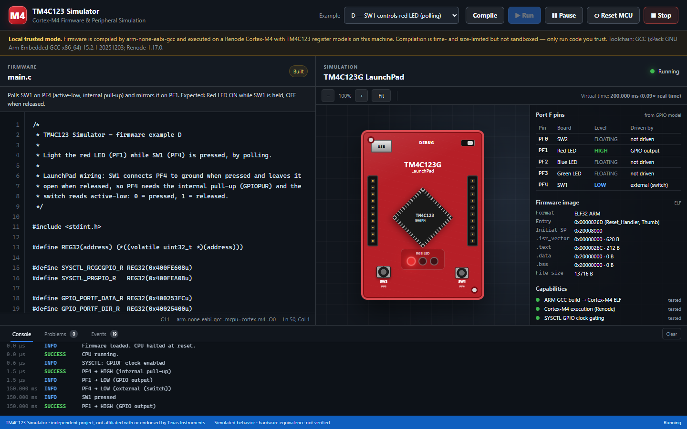
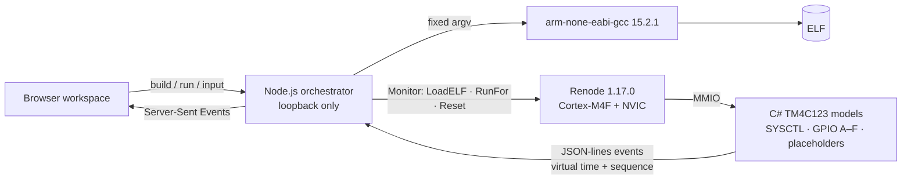

<div align="center">

# TM4C123 Simulator

### Cortex-M4 Firmware & Peripheral Simulation

Real C firmware → `arm-none-eabi-gcc` → Cortex-M4 ELF → Renode → TM4C123
register-level models → browser.

[](https://github.com/Khaledbaniodeh/TM4C123-simulator/actions/workflows/ci.yml)




<sub>Screenshot captured by the automated Playwright test while SW1 is held:
PF4 reads LOW from the switch, the polling firmware drives PF1 HIGH, and the
red LED reflects the GPIO model's event.</sub>

</div>

---

## What this is

A simulator for the TM4C123G LaunchPad that **executes real compiled
firmware** and models TM4C123GH6PM peripherals **at the register level**.
Everything the board view shows is derived from events emitted by those
models while the Cortex-M4 executes your code. No frontend animation,
source-text matching, or wall-clock timer decides hardware state.

Use cases: learning register-level programming (GPIO, interrupts, clock
gating), testing small bare-metal programs without hardware, and
reproducible, scriptable firmware experiments.

> [!IMPORTANT]
> **Status: early technical prototype.** The first end-to-end path
> (RISK-001) is implemented and verified by automated tests. GPIO, GPIO
> interrupts, and the related fault behavior work. Timers, ADC, UART, and
> the LCD are **not modeled yet**. Simulated behavior has **not** been
> compared against a physical LaunchPad.

## What works today

| Capability | Status |
|---|---|
| C → Cortex-M4 ELF with original bare-metal startup + linker script | ✅ Implemented & tested |
| Execution on Renode 1.17.0 (Cortex-M4F + NVIC) | ✅ Implemented & tested |
| SYSCTL GPIO clock gating (`RCGCGPIO`, legacy `RCGC2`, `PRGPIO`) | ✅ Implemented & tested |
| GPIO A–F: masked DATA, DIR, DEN, pull-up/down, open drain | ✅ Implemented & tested |
| PF0 `GPIOLOCK`/`GPIOCR` commit protection | ✅ Implemented & tested |
| GPIO edge interrupts → NVIC → firmware ISR → ICR | ✅ Implemented & tested (falling edge) |
| Precise bus faults: unclocked GPIO, reserved addresses | ✅ Implemented & tested |
| On-board RGB LED (PF1–PF3) and SW1/SW2 (PF4/PF0) | ✅ Implemented & tested |
| Reset, deterministic virtual time, structured runtime events | ✅ Implemented & tested |
| Browser workspace: editor, compile/run/pause/reset/stop, diagnostics, pin inspector | ✅ Implemented & tested (Playwright) |
| SysTick | 🟡 Provided by Renode's NVIC; not yet verified |
| PLL/RCC clock tree, GPTM timers, ADC0, UART0, LCD1602 | 📋 Planned — accesses are **reported**, never silently accepted |
| Keil ARMASM sources, CMSIS `TM4C123.h` lab code | ⛔ Not supported yet ([details](docs/EXPERIMENT_COMPATIBILITY.md)) |

Lab coverage for Experiments 5–10 is tracked in
[`docs/EXPERIMENT_COMPATIBILITY.md`](docs/EXPERIMENT_COMPATIBILITY.md).

## Architecture



- **Virtual time is authoritative.** The orchestrator advances emulation
  time with `RunFor`, so runs are deterministic. Wall-clock pacing is only
  for display, and the UI shows the measured real-time factor.
- **No log scraping.** Pin state comes from model events. CPU faults come
  from the ARMv7-M SCB registers (CFSR/HFSR/BFAR).
- **Unsupported is visible.** Unmodeled registers and peripherals emit
  events, and reserved addresses bus-fault.

More detail: [`docs/TECHNICAL_OVERVIEW.md`](docs/TECHNICAL_OVERVIEW.md) ·
[`docs/PERIPHERAL_MODELS.md`](docs/PERIPHERAL_MODELS.md) ·
[`docs/RUNTIME_EVENTS.md`](docs/RUNTIME_EVENTS.md) ·
[`docs/DECISION_LOG.md`](docs/DECISION_LOG.md)

## Quick start

Requirements: **Node.js ≥ 20.11**, Windows x64 or Linux x64, ~2 GB disk
for the toolchains. No administrator rights are needed.

```bash
git clone https://github.com/Khaledbaniodeh/TM4C123-simulator.git
cd TM4C123-simulator
npm run setup:tools    # downloads pinned GCC + Renode into .tools/ and verifies SHA-256
npm ci
npm start              # http://127.0.0.1:5123/
```

`setup:tools` installs exactly the versions in
[`tools.lock.json`](tools.lock.json) (xPack arm-none-eabi-gcc 15.2.1-1.1,
Renode 1.17.0) into the gitignored `.tools/` directory. Delete that
directory to remove them. Stop the server with **Ctrl+C**, which also shuts
down Renode cleanly.

> [!WARNING]
> The server is a **local, trusted, single-user** tool. It binds to
> `127.0.0.1` only. Compilation and execution are time- and size-limited
> child processes but **not sandboxed**, so run only code you trust. See
> [`SECURITY.md`](SECURITY.md).

## Firmware examples

| Example | Shows |
|---|---|
| [`gpiof-red-led`](examples/gpiof-red-led/main.c) | **A** — clock enable + PRGPIO wait, PF1 output HIGH → red LED on |
| [`gpiof-led-off`](examples/gpiof-led-off/main.c) | **B** — identical configuration, DATA LOW → LED off |
| [`gpiof-blink`](examples/gpiof-blink/main.c) | **C** — masked DATA alias + software delay blink |
| [`sw1-red-led`](examples/sw1-red-led/main.c) | **D** — SW1 active-low input with internal pull-up, polled |
| [`switch-interrupts`](examples/switch-interrupts/main.c) | **E** — PF0 unlock, falling-edge GPIO interrupts, NVIC IRQ 30, ISR |

Negative fixtures (missing clock / DIR / DEN, compile and link errors,
unsupported accesses) are in [`tests/fixtures/firmware/`](tests/fixtures/firmware/).

## Tests and evidence

```bash
npm test                          # 31 tests: compiler, Renode integration, API, board state
npm run test:e2e                  # 4 browser tests (after: npx playwright install chromium)
PW_CHANNEL=msedge npm run test:e2e   # or use an installed Edge/Chrome instead
```

Results, gate-by-gate evidence, and known limitations are in the
[**RISK-001 Acceptance Report**](docs/RISK-001_Acceptance_Report.md). Some
highlights it documents:

- Examples A and B differ only in the DATA value and produce different pin
  states.
- Firmware without `RCGCGPIO` takes a **precise bus fault → HardFault** with
  `BFAR = 0x40025400`, as documented for the silicon.
- Reset returns pins to reset state, and the CPU restarts from the vector
  table.
- Two runs of the blink firmware produce identical edge timestamps.

## Limitations

- No container isolation yet. Local trusted use only.
- Only the 16 MHz PIOSC reset clock. PLL/RCC are not modeled, and timing is
  approximate (one instruction per cycle at 16 MIPS).
- Interactive runs are slower than real time on Windows (0.1–0.8× measured).
- Peripherals beyond SYSCTL/GPIO are placeholders.
- **No comparison with physical hardware has been performed.**

## Roadmap

Next: the clock tree (RCC/RCC2/PLL) and SysTick verification → GPTM timers
(Exp. 7) → ADC0 SS3 (Exp. 9) → UART0 + virtual terminal (Exp. 10) →
LCD1602 (Exp. 8) → container worker. See [`ROADMAP.md`](ROADMAP.md) and
[`PROJECT_STATUS.md`](PROJECT_STATUS.md).

## Repository layout

```text
apps/orchestrator/   Node.js server: compiler runner, Renode session, HTTP/SSE API
apps/web/            Browser workspace (no build step)
simulator/firmware/  Bare-metal startup.s and linker.ld for TM4C123GH6PM
simulator/renode/    Renode platform (.repl) and C# peripheral models
examples/            Firmware examples A–E
tests/               Node test suites + negative firmware fixtures
e2e/                 Playwright browser tests
docs/                Architecture, decisions, models, events, reports
```

## Contributing and feedback

Technical review is very welcome, especially on silicon behavior, timing
fidelity, and test programs to validate against real hardware. The specific
questions are in [`docs/TECHNICAL_OVERVIEW.md` §8](docs/TECHNICAL_OVERVIEW.md#8-where-expert-feedback-would-be-most-valuable).
See [`CONTRIBUTING.md`](CONTRIBUTING.md) and [`HELP_WANTED.md`](HELP_WANTED.md).

## Disclaimer

An independent project. It is **not affiliated with, sponsored by, or
endorsed by Texas Instruments**, Antmicro/Renode, Wokwi, or any university.
TM4C123, Tiva, and LaunchPad are trademarks of their respective owners.
Register behavior is implemented from public datasheet descriptions.
Simulation results are not a substitute for testing on hardware.
