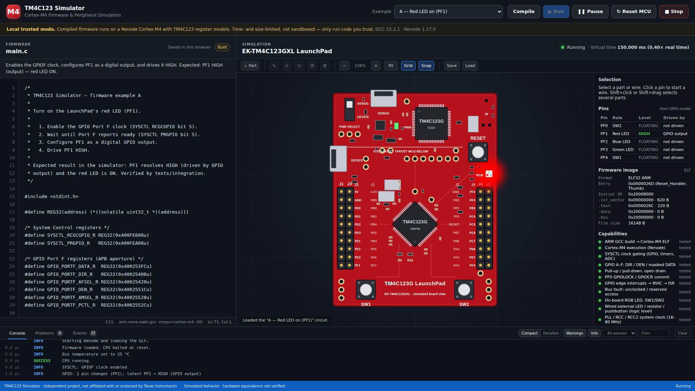
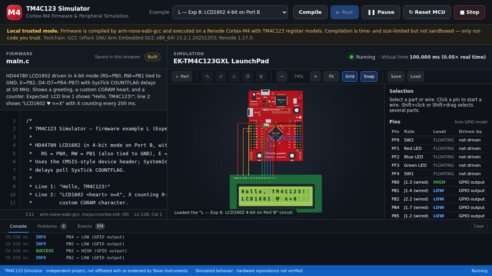
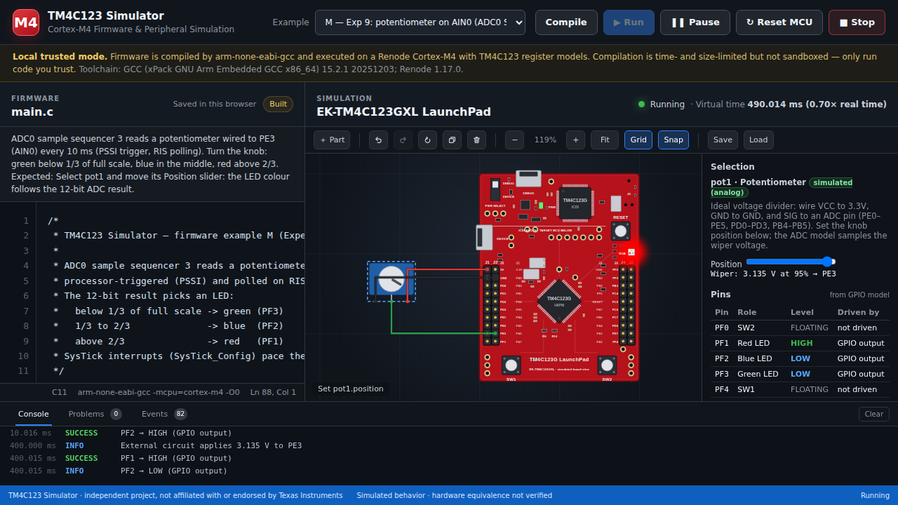
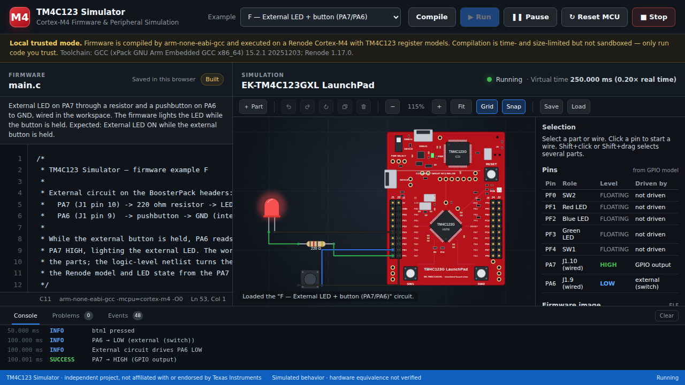
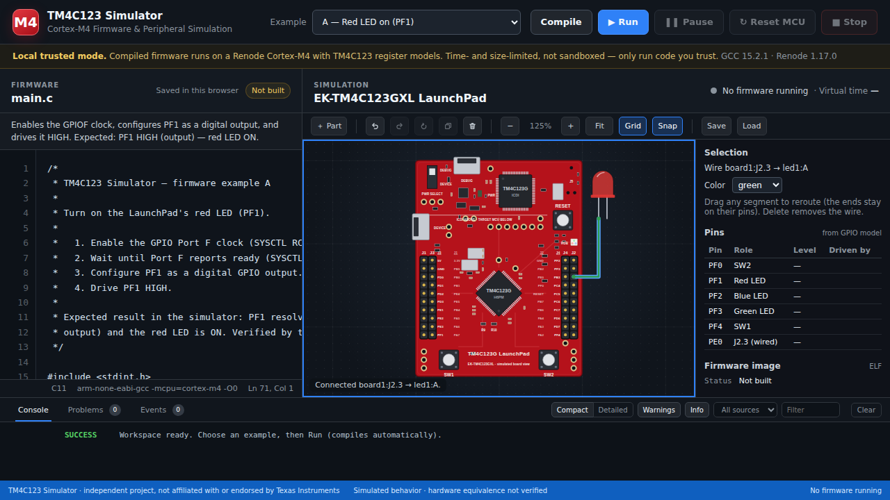
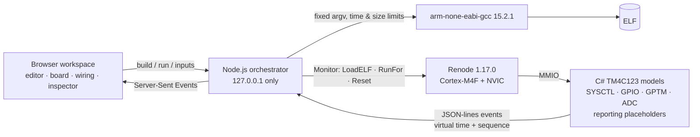

<div align="center">

# TM4C123 Simulator

### Real Cortex-M4 firmware, running on simulated TM4C123 silicon, in an interactive circuit workspace

C source → `arm-none-eabi-gcc` → Cortex-M4 ELF → Renode → register-level TM4C123 models → browser

[](https://github.com/Khaledbaniodeh/TM4C123-simulator/actions/workflows/ci.yml)




<sub>Captured by the automated showcase test: example A was compiled with GCC,
executed in Renode, and drove PF1 HIGH through the GPIO model. The LED, pin
table, ELF summary and console are all projections of simulator events.</sub>

</div>

---

## What it is

A simulator for the **EK-TM4C123GXL LaunchPad** that compiles your C code
with the real ARM GCC toolchain and **executes the resulting ELF** on a
Cortex-M4F in [Renode](https://renode.io/), with TM4C123GH6PM peripherals
modeled **at the register level** in C#. A browser workspace shows the board,
lets you wire external parts to its header pins, and reflects only what the
simulated MCU actually does.

It is built for learning and demonstrating bare-metal programming (GPIO,
interrupts, clocks, timers, LCD, ADC) without a board, and for reproducible,
scriptable firmware experiments.

## Why it is technically interesting

- **The firmware really runs.** No source-text matching or scripted
  animation: the LEDs, the LCD and the pin table change only because the
  compiled code wrote to simulated registers.
- **Register-level models with real failure modes.** Clock gating
  (`RCGCGPIO`/`PRGPIO`), the PF0 commit lock, open drain and pulls, edge
  interrupts through the NVIC, and **precise bus faults** (a missing clock
  enable produces a HardFault with the documented `BFAR`).
- **Deterministic virtual time.** The orchestrator advances emulation in
  fixed `RunFor` steps; repeated runs produce identical event timestamps.
- **Board geometry from TI's CAD data.** The LaunchPad is placed from the
  SPMR240 design files, and all 40 header pins are checked in CI against
  TI's SPMU296 user guide.
- **A circuit workspace driven by the MCU.** Wires form a logic-level
  netlist and a potentiometer forms an ideal divider; both feed the GPIO and
  ADC models as real inputs. An HD44780 LCD decodes the firmware's own GPIO
  writes.
- **Honest about gaps.** Unmodeled peripherals and registers are reported
  as events instead of silently "working"; the UI labels what is tested.

## Gallery

| | |
|---|---|
|  |  |
| **LCD1602 (HD44780)** on Port B, driven only by the firmware's GPIO writes (example L) | **Potentiometer → ADC0** on PE3/AIN0; the firmware picks the LED colour from the 12-bit result (example M) |
|  |  |
| **External button and LED** wired to J1: holding the button lights the LED through the firmware (example F) | **Wiring:** press on a pin, drag, release on another pin; the wire is validated and undoable |

## What works today

**Simulation (Renode + C# models).** Each row has automated tests, unless marked.

| Area | Scope |
|---|---|
| Toolchain | Pinned xPack `arm-none-eabi-gcc` 15.2.1 and Renode 1.17.0, SHA-256 verified; original startup code, linker script and CMSIS-style `TM4C123.h` |
| Core | Cortex-M4F + NVIC, vector-table boot, reset, deterministic virtual time |
| SYSCTL | GPIO/timer/ADC clock gating; RCC/RCC2/PLL clock tree (16–80 MHz) |
| GPIO A–F | Masked DATA, DIR, DEN, pull-up/down, open drain, PF0 LOCK/CR, analog mode, edge interrupts (falling edge tested) |
| SysTick | Interrupt and `COUNTFLAG` polling at the core clock |
| GPTM | TIMER0–5, 16/32-bit periodic with prescaler, timeout interrupts (TIMER0A–2A tested) |
| ADC0/ADC1 | Sample sequencer 3, processor trigger, internal temperature sensor (SS0–SS2 implemented, untested) |
| Faults | Precise bus faults on unclocked and reserved accesses; CPU fault details from the SCB registers |
| Not modeled | UART, SSI, I2C, PWM and others: **accesses are reported, never silently accepted** |

**Workspace (browser).**

| Area | Scope |
|---|---|
| Board | 40 wireable header pins with live tooltips; SW1/SW2 and RESET; firmware-driven RGB LED; selectable components with honest status |
| Parts | LED, resistor, pushbutton (logic level), potentiometer (ideal divider), LCD1602 (HD44780); logic analyzer is **editor only** |
| Editing | Drag, rotate, duplicate, delete, multi-selection, copy/paste, nudging, undo/redo; new parts placed on free canvas |
| Wiring | Click-to-click or drag-to-connect; pan while wiring; orthogonal routes on a 0.1 in grid that keep clear of unrelated pin pads; segment rerouting; validation of shorts and duplicates |
| Compile problems | Errors, warnings, and notes from GCC and the linker in a Problems list; each goes to its line and column (F8 / Shift+F8 step through them), lines marked in the gutter; linker errors without a line are listed as such, never given one |
| Inspector | Live pin table (digital levels, drivers, and AIN channel + modeled voltage for ADC inputs), ELF summary, capability list |
| Files and safety | `diagram.json` save/load (Wokwi-inspired, full compatibility **not** claimed); source and circuit kept in browser storage across reloads; confirmation before an example or a file replaces edited work; keyboard-accessible toolbar (wiring itself needs a pointer) |

Lab coverage for Experiments 5–10:
[`docs/EXPERIMENT_COMPATIBILITY.md`](docs/EXPERIMENT_COMPATIBILITY.md).

## Architecture



- **Virtual time is authoritative.** Wall-clock pacing is only for display;
  the UI shows the measured real-time factor.
- **No log scraping.** Pin state comes from model events; CPU faults come
  from the ARMv7-M SCB registers (CFSR/HFSR/BFAR).
- **The browser never decides hardware state.** External parts only turn
  wiring into pin drives that the GPIO and ADC models apply.

Details: [`docs/TECHNICAL_OVERVIEW.md`](docs/TECHNICAL_OVERVIEW.md) ·
[`docs/PERIPHERAL_MODELS.md`](docs/PERIPHERAL_MODELS.md) ·
[`docs/RUNTIME_EVENTS.md`](docs/RUNTIME_EVENTS.md) ·
[`docs/DECISION_LOG.md`](docs/DECISION_LOG.md) ·
[`docs/PERFORMANCE.md`](docs/PERFORMANCE.md)

## Quick start

Requirements: **Node.js ≥ 20.11**, Windows x64 or Linux x64, about 2 GB of
disk for the toolchains. No administrator rights are needed.

```bash
git clone https://github.com/Khaledbaniodeh/TM4C123-simulator.git
cd TM4C123-simulator
npm run setup:tools    # downloads pinned GCC + Renode into .tools/ and verifies SHA-256
npm ci
npm start              # http://127.0.0.1:5123/
```

`setup:tools` installs exactly the versions in [`tools.lock.json`](tools.lock.json)
into the gitignored `.tools/` directory; delete it to uninstall. **Ctrl+C**
stops the server and shuts Renode down cleanly.

A guided 10-minute walkthrough for presentations:
[`docs/SHOWCASE_DEMO.md`](docs/SHOWCASE_DEMO.md).

## Firmware examples

| Example | Shows |
|---|---|
| [`gpiof-red-led`](examples/gpiof-red-led/main.c) | **A**: clock enable + PRGPIO wait, PF1 output HIGH → red LED on |
| [`gpiof-led-off`](examples/gpiof-led-off/main.c) | **B**: identical configuration, DATA LOW → LED off |
| [`gpiof-blink`](examples/gpiof-blink/main.c) | **C**: masked DATA alias + software delay blink |
| [`sw1-red-led`](examples/sw1-red-led/main.c) | **D**: SW1 active-low input with internal pull-up, polled |
| [`switch-interrupts`](examples/switch-interrupts/main.c) | **E**: PF0 unlock, falling-edge GPIO interrupts, NVIC IRQ 30, ISR |
| [`external-led-button`](examples/external-led-button/main.c) | **F**: external LED (PA7 + 220 Ω) and pushbutton (PA6 → GND) wired in the workspace |
| [`systick-blink`](examples/systick-blink/main.c) | **G**: RCC2/PLL to 50 MHz, SysTick interrupt every 100 ms |
| [`timer1a-prescaled`](examples/timer1a-prescaled/main.c) | **H**: TIMER1A 16-bit periodic with prescaler 256 |
| [`three-timers`](examples/three-timers/main.c) | **I**: TIMER0A/1A/2A at 250/500/1000 ms |
| [`lab-gpio-interrupts`](examples/lab-gpio-interrupts/main.c) | **J**: Experiment 6 style with `TM4C123.h` (`GPIOF->…`, `NVIC_EnableIRQ`) |
| [`lab-systick-timer`](examples/lab-systick-timer/main.c) | **K**: Experiment 7 style with `SysTick_Config(SystemCoreClock / 10)` |
| [`lcd1602-hello`](examples/lcd1602-hello/main.c) | **L**: Experiment 8, LCD1602 4-bit on Port B with a CGRAM character |
| [`adc-potentiometer`](examples/adc-potentiometer/main.c) | **M**: Experiment 9, ADC0 SS3 reads a potentiometer on PE3/AIN0 |
| [`adc-temperature`](examples/adc-temperature/main.c) | **N**: Experiment 9, internal temperature sensor on ADC1 SS3 with an ISR |

Negative fixtures (missing clock / DIR / DEN, compile and link errors,
unsupported accesses) are in [`tests/fixtures/firmware/`](tests/fixtures/firmware/).

## Tests and evidence

```bash
npm test           # Node: compiler, Renode integration, API, peripherals, workspace model, board pin map
npm run test:e2e   # Playwright: real UI against the real toolchain and Renode
```

On this release candidate, CI ([`ci.yml`](.github/workflows/ci.yml)) runs
**135 Node tests and 98 browser tests** with the pinned toolchains; every
browser test compiles and executes real firmware where it needs to. Browser
screenshots from each run are published to the
[`ci-artifacts`](https://github.com/Khaledbaniodeh/TM4C123-simulator/tree/ci-artifacts)
branch. [`hardware-reference.yml`](.github/workflows/hardware-reference.yml)
re-checks the board model against TI's documents, and
[`perf-probe.yml`](.github/workflows/perf-probe.yml) measures simulation
speed. The first end-to-end proof and its negative cases are documented in
the [RISK-001 Acceptance Report](docs/RISK-001_Acceptance_Report.md).

## Limitations

- **Local, trusted, single-user tool.** The server binds to `127.0.0.1` and
  checks the `Host` header, but compilation and execution are **not
  sandboxed** (time- and size-limited child processes only). Do not expose it
  to untrusted users or the internet. There is **no public hosted version**.
  See [`SECURITY.md`](SECURITY.md).
- **Not compared with physical hardware.** Behavior is implemented from
  public datasheet descriptions and verified by tests, not against a real
  LaunchPad.
- **Approximate timing.** One instruction per clock at the configured system
  clock; not cycle-accurate. Interactive runs are slower than real time
  (0.1–0.8× on Windows); firmware that busy-polls a register runs at about
  0.13× in CI, while interrupt + `WFI` code runs at real time
  ([`docs/PERFORMANCE.md`](docs/PERFORMANCE.md)).
- **Peripheral coverage.** UART, SSI, I2C, PWM and others are placeholders
  that report accesses. The logic analyzer is not functional yet.
- **Simplified electrical model.** External parts are logic-level; the
  potentiometer is an ideal divider without loading.
- **Known workspace rough edges** are tracked in
  [`PROJECT_STATUS.md`](PROJECT_STATUS.md#known-issues), for example
  wires in older saved circuits keep their routes, which can pass over
  header pads (new wires are routed clear of them).

## Roadmap

Next: UART0 with a virtual terminal (Experiment 10), a container-isolated
compile/execute worker (required before any shared deployment), and a
logic analyzer. See [`ROADMAP.md`](ROADMAP.md) and
[`PROJECT_STATUS.md`](PROJECT_STATUS.md).

## Repository layout

```text
apps/orchestrator/   Node.js server: compiler runner, Renode session, HTTP/SSE API
apps/web/            Browser workspace (plain ES modules, no build step)
simulator/firmware/  Startup, linker script, device header (include/), SystemInit
simulator/renode/    Renode platform (.repl) and C# peripheral models
examples/            Firmware examples A–N (with diagram.json where wired)
tests/               Node test suites + negative firmware fixtures
e2e/                 Playwright browser tests, including the showcase walkthrough
docs/                Architecture, decisions, models, events, reports
```

## Contributing and feedback

Technical review is very welcome, especially on silicon behavior, timing
fidelity, and reference programs to validate against real hardware. See
[`docs/TECHNICAL_OVERVIEW.md` §8](docs/TECHNICAL_OVERVIEW.md#8-where-expert-feedback-would-be-most-valuable),
[`CONTRIBUTING.md`](CONTRIBUTING.md) and [`HELP_WANTED.md`](HELP_WANTED.md).

## Disclaimer

An independent project. It is **not affiliated with, sponsored by, or
endorsed by Texas Instruments**, Antmicro/Renode, Wokwi, or any university.
TM4C123, Tiva, and LaunchPad are trademarks of their respective owners.
Simulation results are not a substitute for testing on hardware.
