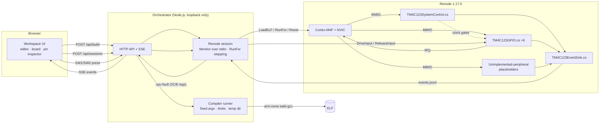

# TM4C123 Simulator — Technical Overview

*Cortex-M4 Firmware & Peripheral Simulation — technical preview*

An independent project. Not affiliated with or endorsed by Texas
Instruments. Prepared for review by embedded-systems engineers.

## 1. Problem

Students and engineers learning register-level programming on the
TM4C123G LaunchPad need hardware to see whether their firmware is right. A
useful simulator has to execute the **real compiled firmware** and model
TM4C123 peripherals at the **register level**, including the failure modes
(clock gating, commit-protected pins, bus faults). Visualizations driven by
anything other than executed code teach the wrong lessons.

## 2. What is implemented (and tested)

- C source → **arm-none-eabi-gcc 15.2.1** → Cortex-M4 ELF with an original
  bare-metal startup (155-entry vector table, `.data`/`.bss` init) and
  linker script for TM4C123GH6PM (256 KB Flash, 32 KB SRAM).
- **Renode 1.17.0** executes the ELF on a Cortex-M4F core with its NVIC.
- Custom **C# register models**: SYSCTL clock gating and the RCC/RCC2/PLL
  clock tree; GPIO ports A–F with masked DATA, DIR, DEN, pulls, open drain,
  LOCK/CR commit protection, analog mode, edge/level interrupts to the NVIC;
  GPTM TIMER0–5; ADC0/ADC1 with the temperature sensor; bus faults on
  unclocked access and on reserved addresses; named placeholders that report
  accesses to unmodeled peripherals (UART, SSI, I2C, PWM, …).
- **Workspace parts** evaluated from simulator events: external LED,
  resistor, pushbutton (logic level), LCD1602 (HD44780), potentiometer
  (ideal divider into the ADC model).
- **Structured events** (JSON lines with sequence numbers and virtual time)
  streamed to a browser workspace over SSE. The LEDs, pin table, and fault
  badge are projections of those events.
- **Fourteen firmware examples** (A–N): GPIO output and input, interrupts
  with PF0 unlock, clock tree, SysTick, GPTM timers, LCD1602, ADC with a
  potentiometer and the temperature sensor; see the README.
- **Automated tests:** 174 Node tests and 141 browser tests in CI,
  including all RISK-001 negative cases
  ([`RISK-001_Acceptance_Report.md`](RISK-001_Acceptance_Report.md)) and a
  showcase walkthrough ([`SHOWCASE_DEMO.md`](SHOWCASE_DEMO.md)).

## 3. Execution architecture

Key design choices (see [`DECISION_LOG.md`](DECISION_LOG.md)):

- **Virtual time is authoritative** (D-013). The orchestrator advances time
  with `emulation RunFor`, so runs are deterministic for the same firmware
  and input schedule. Wall-clock pacing is only for display.
- **No log scraping** (D-019). State comes from model events and from the
  ARMv7-M SCB fault registers.
- **Faults over silence** (D-020). Invalid accesses fault or are reported
  as events; nothing unsupported silently succeeds.

## 4. Demonstrated behavior

| Behavior | How it is demonstrated |
|---|---|
| Firmware-driven PF1 HIGH vs LOW with identical configuration | Examples A and B; integration, API, and browser tests |
| Missing `RCGCGPIO` → precise bus fault → HardFault (BFAR = `0x40025400`) | `missing-clock` fixture |
| Missing `GPIODIR` / `GPIODEN` → PF1 not driven | Negative fixtures |
| MCU reset → pins to reset state, CPU reloads SP/PC from the vector table | Integration + browser tests |
| SW1 active-low input through the internal pull-up | Example D |
| PF0 lock/commit: blocked without the unlock key, works with it | Example E + locked negative test |
| GPIO falling-edge interrupt → NVIC IRQ 30 → `GPIOF_Handler` → ICR clear | Example E |
| Unmodeled register / peripheral / reserved address | Events + bus fault |
| Deterministic timing | Identical blink edge timestamps across runs |

## 5. Verification approach

1. **Fixture-driven negative testing.** Every rule in RISK-001 §7 has a
   firmware fixture that violates it.
2. **Observable architectural state.** Assertions use model events, the
   model's resolved pin state, and CPU/SCB registers (xPSR, CFSR, HFSR, BFAR).
3. **Same code path everywhere.** Tests, the API, and the browser all use
   the same compiler runner and Renode session.
4. **Browser proof.** Playwright drives the real UI against the real
   toolchain. Screenshots in `docs/images/` come from those runs.
5. **Pinned, checksummed toolchains** on Windows and Linux CI.

## 6. Current limitations

- Local, trusted, single-user mode only. No container isolation yet.
- UART is not modeled yet (Experiment 10).
- Approximate timing: 1 instruction per clock at the configured system clock
  (decision D-030); event timestamps at translation-block granularity.
- Interactive runs reach ~0.5–0.8× real time on Windows (Monitor round-trip
  latency). The UI shows the measured factor.
- No physical-hardware comparison yet.
- Lab code using CMSIS `TM4C123.h` or Keil ARMASM needs the prerequisites in
  D-023 ([`EXPERIMENT_COMPATIBILITY.md`](EXPERIMENT_COMPATIBILITY.md)).

## 7. Engineering challenges ahead

- A faithful **clock tree** (PIOSC/MOSC/PLL, SYSDIV) driving the CPU rate,
  SysTick, GPTM, and UART baud generation.
- **GPTM** 16/32-bit modes with prescalers, plus interrupt timing exactness.
- **ADC** sampling model: sequencer FIFO, trigger sources, and conversion
  timing with a deterministic analog input.
- **UART0** with an interactive terminal, without breaking determinism
  (input must be timestamped in virtual time).
- An **HD44780 model** that respects controller timing (busy times) without
  hiding firmware delay bugs.
- **Isolation** for untrusted firmware and compilation suitable for a
  hosted service.

## 8. Where expert feedback would be most valuable

1. Silicon behavior for: GPIO access with the clock gated *after*
   configuration; reads of reserved address space; mixed use of `RCGC2` and
   `RCGCGPIO`.
2. Which timing details matter most for teaching (flash wait states?
   interrupt latency? GPTM synchronization?), and how cycle-accurate they
   should be.
3. Review of the GPIO interrupt model (edge detection on output-driven
   pins, level-sensitive re-assertion after ICR).
4. Licensing guidance for a TM4C123 device header and startup code
   compatible with existing lab material.
5. Recommended reference test programs to validate against a LaunchPad.

## 9. Demonstration script (≈ 5 minutes)

Prerequisites: `npm run setup:tools && npm ci && npm start`, then open
<http://127.0.0.1:5123/>.

1. **Real toolchain.** Point at the notice bar, which shows the GCC and
   Renode versions reported by the server. Select **A — Red LED on**, click
   **Run**. The console shows the build (ELF size, entry address), then
   `SYSCTL: GPIOF clock enabled`, `PF1 → LOW (GPIO output)`,
   `PF1 → HIGH (GPIO output)`. The red LED lights.
2. **Not a mirror of source text.** Select **B — Red LED off** (same
   configuration, DATA low) and Run. PF1 is a LOW output and the LED stays
   off.
3. **Failure modes.** In example A, delete the `SYSCTL_RCGCGPIO_R |= …`
   line and Run. The firmware spins forever in its `PRGPIO` ready-wait (as
   it would on hardware) and PF1 stays undriven. Now also delete the
   `while (… PRGPIO …)` loop and Run again. The first GPIOF access
   (`GPIOAFSEL`) raises a precise bus fault, the console shows
   `CPU entered HardFault (… CFSR 0x00008200, HFSR 0x40000000, BFAR 0x40025420)`,
   and the board shows `HardFault · BFAR 0x40025420`.
4. **Compile errors are real.** Type a syntax error and Run. The Problems
   tab lists GCC's diagnostics with line numbers; nothing executes.
5. **Reset.** Pause, then **Reset MCU**. PF1 goes to FLOATING and the LED
   turns off. Resume, and the firmware runs again from the vector table.
6. **Input and interrupts.** Select **E — SW1/SW2 interrupts**, Run, then
   click SW1 and SW2. Each press toggles red/green from `GPIOF_Handler`. The
   Events tab shows `interrupt-line-changed` asserted, then cleared by ICR.
7. **Honesty.** Show the Capabilities list (tested vs not modeled) and the
   footer: independent project, hardware equivalence not verified.
